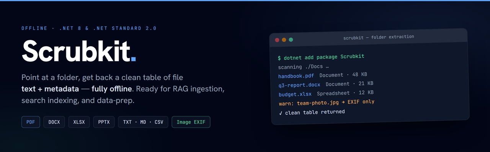

# Scrubkit



[](https://github.com/jjopensoftworks-blip/Scrubkit/actions/workflows/ci.yml)
[](https://www.nuget.org/packages/Scrubkit)
[](https://www.nuget.org/packages?q=Scrubkit)
[](LICENSE)

**Point at a folder, get a clean table of file text + metadata back — 100% offline.**

Scrubkit walks a directory and extracts text and metadata from common file types (PDF, Word, Excel, PowerPoint, Email, OpenDocument, EPUB, Plain Text, EXIF), returning one row per file.

> 💡 **Need to turn your RAG / LLM Markdown output into a polished vector PDF?** Pair **Scrubkit** (input ingestion & PII redaction) with **[ShreePdf](https://www.nuget.org/packages/ShreePdf)** ([Live Playground](https://jjopensoftworks-blip.github.io/ShreePdfPage/)) — our high-speed, zero-Chromium vector PDF engine for .NET 8 & 10 with direct Markdown/HTML ingestion, native charts, and auto-fit pagination.

---

## 🔗 End-to-End .NET AI Pipeline: `Folder → Scrubkit → LLM → ShreePdf`

Every enterprise AI workflow in .NET needs **safe document input** (`Scrubkit`) and **executive-ready document output** (`ShreePdf`). Here is the complete pipeline in 20 lines of C#:

```csharp
using Microsoft.Extensions.AI;
using Scrubkit;
using ShreePdf.Fluent;

// 1. INGEST & REDACT: Extract text from PDFs, Word, Excel & Emails offline + scrub PII/secrets
var scrubber = new FolderScrubber(new ReadOptions { Redaction = RedactionLevel.Standard }.AddAllExtractors());
var records = await scrubber.ReadAsync(@"C:\data\quarterly-filings");

// 2. SUMMARIZE: Pass sanitized text through Microsoft.Extensions.AI (zero PII leaked to LLM)
string context = string.Join("\n\n", records.Select(r => $"### {r.Name}\n{r.Text}"));
ChatResponse summary = await chatClient.GetResponseAsync(
    $"Create a Markdown executive summary with key risks and metrics from:\n{context}");

// 3. PUBLISH: Render the LLM Markdown straight to a themed, auto-fitted vector PDF via ShreePdf
Document.FromMarkdown(summary.Text, ThemePresets.SaaSAnalytics)
    .EnableAutoFit()
    .AddPageNumber("Page {page} of {pages}")
    .Save("Executive-Briefing.pdf");
```

---

## 📚 Documentation & Ecosystem Portal

Explore complete Scrubkit documentation, integration recipes, and API references on our web portal:

| Resource | Description | Destination Link |
| :--- | :--- | :--- |
| **🌐 Official Website** | Interactive product overview, performance benchmarks, and architecture. | [**Visit Site →**](https://jjopensoftworks-blip.github.io/Scrubkit/) |
| **🤖 RAG & AI Recipes** | End-to-end recipes for `Microsoft.Extensions.AI`, `Semantic Kernel`, `ShreePdf`, vector stores, and Parquet. | [**View RAG Recipes →**](https://jjopensoftworks-blip.github.io/Scrubkit/recipes.html) \| [**Markdown**](docs/RAG-INGESTION-RECIPES.md) |
| **💻 CLI Command Guide** | Zero-code folder scanning via `scrubkit scan`, output formatting, and CI secret scanning. | [**View CLI Guide →**](src/Scrubkit.Tool/README.md) |
| **📦 Package Family** | Full matrix of all 14 Scrubkit packages (`Core`, `Abstractions`, `Pdf`, `Images`, `Email`, `Parquet`, etc.). | [**Explore Packages →**](https://jjopensoftworks-blip.github.io/Scrubkit/#packages) |
| **🧪 Interactive Demo** | Runnable demo console application on synthetic sample files. | [**Run Playground →**](samples/Scrubkit.Playground) |
| **📝 Release History** | Version changelogs, feature additions, and API update notes. | [**View Changelog →**](https://jjopensoftworks-blip.github.io/Scrubkit/changelog.html) |

---

## 🛠️ Related .NET AI & Document Tools by JJ OpenSoftworks

| Tool / Engine | Role in Your Stack | Install / Links |
| :--- | :--- | :--- |
| **[ShreePdf](https://www.nuget.org/packages/ShreePdf)** | **Output Engine:** Turn LLM Markdown, HTML, or C# fluent code into themed vector PDFs with charts, QR codes, AES-256 encryption, and digital signatures (zero Headless Chrome). | `dotnet add package ShreePdf` · [Web Playground](https://jjopensoftworks-blip.github.io/ShreePdfPage/) · [GitHub](https://github.com/jjopensoftworks-blip/ShreePdf) |
| **[ShreePdf Viewer](https://apps.microsoft.com/detail/9MSPJ2M5MFHS)** | **Desktop PDF Utility:** Sub-10ms native Windows vector PDF reader with visual diff, signature inspector, and RAG AST viewer. | [Microsoft Store](https://apps.microsoft.com/detail/9MSPJ2M5MFHS) |
| **[FileOrganizerAI](https://apps.microsoft.com/detail/9N74TVPLHM41)** | **Desktop AI Utility:** 100% offline Windows file organizer powered by on-device AI + smart rules. | [Microsoft Store](https://apps.microsoft.com/detail/9N74TVPLHM41) |

---

## License & Privacy

- **License:** [Mozilla Public License 2.0 (MPL-2.0)](LICENSE) — open and free to use in open or commercial applications.
- **Privacy:** 100% offline. No network requests or telemetry.
